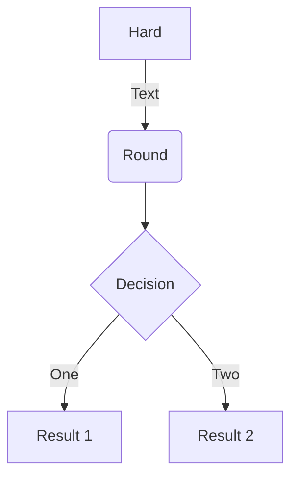
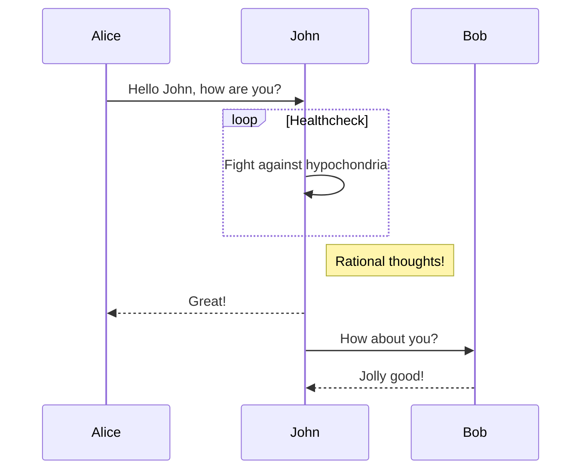
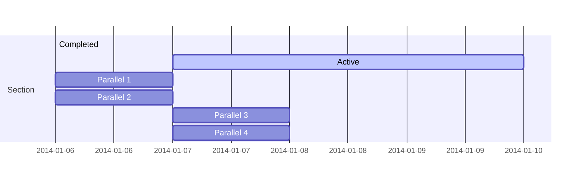
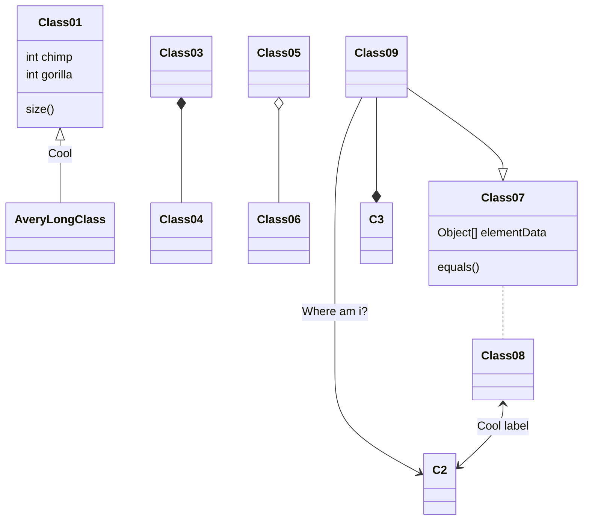
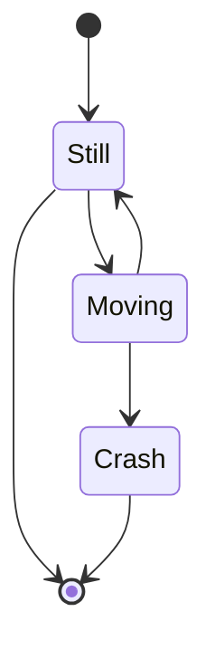

Hugo Blox Builder 旨在为技术内容创作者提供流畅的体验。你可以专注于内容，其余交给 Wowchemy。

**高亮代码片段、记录数学课堂笔记，并通过文字描述绘制图表。**

本页展示了一些可由 Wowchemy 渲染的技术内容示例。

## 示例

### 代码

Wowchemy 支持用于代码语法高亮的 Markdown 扩展。你可以通过 `config/_default/params.yaml` 中的 `syntax_highlighter` 选项定制样式。

    ```python
    import pandas as pd
    data = pd.read_csv("data.csv")
    data.head()
    ```

渲染结果如下

```python
import pandas as pd
data = pd.read_csv("data.csv")
data.head()
```

### 思维导图

Wowchemy 支持用于思维导图的 Markdown 扩展。

只需插入 Markdown `markmap` 代码块，也可以按下面的示例设置思维导图高度。

使用 Markdown 列表定义的简单思维导图：

<div class="highlight">
<pre class="chroma">
<code>
```markmap {height="200px"}
- Hugo Modules
  - wowchemy
  - blox-plugins-netlify
  - blox-plugins-netlify-cms
  - blox-plugins-reveal
```
</code>
</pre>
</div>

渲染结果如下

```markmap {height="200px"}
- Hugo Modules
  - wowchemy
  - blox-plugins-netlify
  - blox-plugins-netlify-cms
  - blox-plugins-reveal
```

包含格式、代码块和数学公式的进阶思维导图：

<div class="highlight">
<pre class="chroma">
<code>
```markmap
- Mindmaps
  - Links
    - [Wowchemy Docs](https://docs.hugoblox.com/)
    - [Discord Community](https://discord.gg/z8wNYzb)
    - [GitHub](https://github.com/HugoBlox/hugo-blox-builder)
  - Features
    - Markdown formatting
    - **inline** ~~text~~ *styles*
    - multiline
      text
    - `inline code`
    -
      ```js
      console.log('hello');
      console.log('code block');
      ```
    - Math: $x = {-b \pm \sqrt{b^2-4ac} \over 2a}$
```
</code>
</pre>
</div>

渲染结果如下

```markmap
- Mindmaps
  - Links
    - [Wowchemy Docs](https://docs.hugoblox.com/)
    - [Discord Community](https://discord.gg/z8wNYzb)
    - [GitHub](https://github.com/HugoBlox/hugo-blox-builder)
  - Features
    - Markdown formatting
    - **inline** ~~text~~ *styles*
    - multiline
      text
    - `inline code`
    -
      ```js
      console.log('hello');
      console.log('code block');
      ```
    - Math: $x = {-b \pm \sqrt{b^2-4ac} \over 2a}$
```

### 图表

Wowchemy 支持使用常见的 [Plotly](https://plot.ly/) 格式创建交互式图表。

将 Plotly JSON 文件保存在页面文件夹中，例如 `line-chart.json`，然后在需要显示图表的位置加入 `` 短代码。

演示：



你也可以使用 [Plotly JSON 编辑器](http://plotly-json-editor.getforge.io/)。

### 数学公式

Wowchemy 支持用于 $\LaTeX$ 数学公式的 Markdown 扩展。可以在 `config/_default/params.yaml` 中通过 `math` 选项启用。

要渲染_行内_或_独立公式块_，分别用 `$...$` 或 `$$...$$` 包裹 LaTeX 公式。（使用 Wowchemy 的 _math_ 短代码是为了防止 Hugo 将公式作为 Markdown 渲染。_math_ 短代码于 v5.5-dev 中加入。）

**公式块**示例：

```latex

$$
\gamma_{n} = \frac{ \left | \left (\mathbf x_{n} - \mathbf x_{n-1} \right )^T \left [\nabla F (\mathbf x_{n}) - \nabla F (\mathbf x_{n-1}) \right ] \right |}{\left \|\nabla F(\mathbf{x}_{n}) - \nabla F(\mathbf{x}_{n-1}) \right \|^2}
$$

```

渲染结果如下


$$\gamma_{n} = \frac{ \left | \left (\mathbf x_{n} - \mathbf x_{n-1} \right )^T \left [\nabla F (\mathbf x_{n}) - \nabla F (\mathbf x_{n-1}) \right ] \right |}{\left \|\nabla F(\mathbf{x}_{n}) - \nabla F(\mathbf{x}_{n-1}) \right \|^2}$$


**行内公式**示例 `$\nabla F(\mathbf{x}_{n})$` 渲染结果如下 $\nabla F(\mathbf{x}_{n})$.

使用公式换行符（`\\`）的**多行公式**示例：

```latex

$$f(k;p_{0}^{*}) = \begin{cases}p_{0}^{*} & \text{if }k=1, \\
1-p_{0}^{*} & \text{if }k=0.\end{cases}$$

```

渲染结果如下



$$
f(k;p_{0}^{*}) = \begin{cases}p_{0}^{*} & \text{if }k=1, \\
1-p_{0}^{*} & \text{if }k=0.\end{cases}
$$



### 示意图

Wowchemy 支持绘图的 Markdown 扩展。可以在 `config/_default/params.toml` 中启用 `diagram`，或者在页面元数据中加入 `diagram: true`。

**流程图**示例：

    ```mermaid
    graph TD
    A[Hard] -->|Text| B(Round)
    B --> C{Decision}
    C -->|One| D[Result 1]
    C -->|Two| E[Result 2]
    ```

渲染结果如下



**时序图**示例：

    ```mermaid
    sequenceDiagram
    Alice->>John: Hello John, how are you?
    loop Healthcheck
        John->>John: Fight against hypochondria
    end
    Note right of John: Rational thoughts!
    John-->>Alice: Great!
    John->>Bob: How about you?
    Bob-->>John: Jolly good!
    ```

渲染结果如下



**甘特图**示例：

    ```mermaid
    gantt
    section Section
    Completed :done,    des1, 2014-01-06,2014-01-08
    Active        :active,  des2, 2014-01-07, 3d
    Parallel 1   :         des3, after des1, 1d
    Parallel 2   :         des4, after des1, 1d
    Parallel 3   :         des5, after des3, 1d
    Parallel 4   :         des6, after des4, 1d
    ```

渲染结果如下



**类图**示例：

    ```mermaid
    classDiagram
    Class01 <|-- AveryLongClass : Cool
    Class03 *-- Class04
    Class05 o-- Class06
    Class07 .. Class08
    Class09 --> C2 : Where am i?
    Class09 --* C3
    Class09 --|> Class07
    Class07 : equals()
    Class07 : Object[] elementData
    Class01 : size()
    Class01 : int chimp
    Class01 : int gorilla
    Class08 <--> C2: Cool label
    ```

渲染结果如下



**状态图**示例：

    ```mermaid
    stateDiagram
    [*] --> Still
    Still --> [*]
    Still --> Moving
    Moving --> Still
    Moving --> Crash
    Crash --> [*]
    ```

渲染结果如下



### 待办清单

你还可以用 Markdown 编写待办清单：

```markdown
- [x] Write math example
  - [x] Write diagram example
- [ ] Do something else
```

渲染结果如下

- [x] Write math example
  - [x] Write diagram example
- [ ] Do something else

### 表格

将电子表格保存为页面文件夹中的 CSV 文件，再在页面中添加 _Table_ 短代码进行渲染：

```go

```

渲染结果如下



### 提示框

Academic 支持[提示框短代码](https://docs.hugoblox.com/content/writing-markdown-latex/#callouts)，也称为_旁注_、_提示_或_提醒_。将段落放在 `{} ... {}` 中，即可渲染为旁注。

```markdown
{}
Markdown 旁注可用于向读者展示通知、提示或定义。
{}
```

渲染结果如下

{}
Markdown 旁注可用于向读者展示通知、提示或定义。
{}

### 折叠内容

在页面中添加折叠内容，即可在点击按钮后显示文字，例如问题的答案。

```markdown

你找到我了！

```

渲染结果如下

 你找到我了！ 

### 图标

除了[表情符号](https://docs.hugoblox.com/content/writing-markdown-latex/#emojis)，Academic 还支持丰富的 [_Font Awesome_ 和 _Academicons_ 图标](https://docs.hugoblox.com/getting-started/page-builder/#icons)。

下面展示如何使用 `icon` 短代码渲染图标：

```markdown
 Terminal  
 Python  
 R
```

渲染结果如下

 Terminal  
 Python  
 R

### 觉得本页有帮助？欢迎分享 🙌
